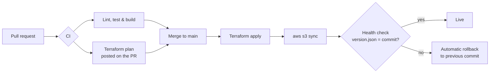

# devops-demo-site

A static website on Amazon S3, with the bucket defined in Terraform and every change shipped by GitHub Actions. Built for the **Getting Started with DevOps** talk (AWS Student Builder Group, USJ).



## What's in the repo

| Path | What it does |
|---|---|
| `site/` | The website: `index.html`, `404.html`, `styles.css` |
| `tests/site.test.mjs` | Fast checks: title, heading, club name, no broken local links |
| `scripts/build.mjs` | Copies `site/` to `dist/` and stamps the commit into the page and `version.json` |
| `infra/` | Terraform: S3 bucket, website hosting, public-read policy, versioning, lifecycle |
| `.github/workflows/ci.yml` | **Pull requests:** lint, test, build, and `terraform plan` posted as a PR comment |
| `.github/workflows/deploy.yml` | **Merge to main:** test, `terraform apply`, upload, health check, auto-rollback |
| `.github/workflows/rollback.yml` | Manual: redeploy any earlier commit |
| `.github/workflows/destroy.yml` | Manual: delete the website bucket after the demo |
| `scripts/setup.sh` | One-time setup from your laptop: AWS bootstrap, repo, variables, branch protection |
| `scripts/aws-profile.sh` | Picks the `ugdemo` AWS profile and asks you to confirm the account |

## How AWS access works (no keys in GitHub)

`scripts/bootstrap-aws.sh` runs once on your laptop using your **`ugdemo` AWS CLI profile**. It creates:

- an S3 bucket for Terraform state, with versioning, encryption and locking
- GitHub's OIDC identity provider
- an IAM role that **only this repo** can assume, and only from pull requests, `main`, or the `production` environment. The role can only touch the website bucket and the state bucket.

After that, every workflow run gets a **short-lived token** (about one hour) from AWS. No AWS keys are stored in GitHub, and your profile's credentials never leave your machine.

## Setup (about 5 minutes)

Prerequisites on your Mac: `brew install gh awscli`, then `gh auth login`.

1. Check the `ugdemo` profile points at the demo account:
   ```bash
   aws sts get-caller-identity --profile ugdemo
   ```
   The profile needs permission to create S3 buckets and IAM roles (for example `AdministratorAccess` on an IAM user, not root keys). If it has no default region, setup uses `us-east-1`.
2. Run setup:
   ```bash
   scripts/setup.sh kalanatd/devops-demo-site
   ```
   It shows the account and region and asks you to confirm, then bootstraps AWS, creates the repo, sets the variables, pushes `main` (this starts the first deploy) and protects `main`, so changes need a pull request with green checks.
   To use another profile or region: `AWS_PROFILE=other AWS_REGION=ap-south-1 scripts/setup.sh`.
3. Watch the first deploy: `gh run watch`. The website URL appears on the **production** environment in the run summary.

## Demo script

**1. Tour the pipeline (Actions tab).** Open the first `Deploy` run and walk through Lint, test & build, then Terraform apply, Deploy to S3 and Health check. Open the live URL and point at the version in the footer: it matches the commit.

**2. Tests locally.**
```bash
npm ci && npm test
```

**3. Infrastructure as code.** Open `infra/main.tf`: one bucket, website hosting, a public-read policy. Show the state bucket in the S3 console, and explain that this is how the pipeline remembers what it built.

**4. Pull request checks.**
```bash
git switch -c feature/new-heading
# change <h1 id="headline">Welcome</h1> to Welcome, Builders!
git commit -am "Friendlier heading" && git push -u origin feature/new-heading
gh pr create --fill
```
Show both checks running, the **Terraform plan comment** ("No changes", because only the website changed), and that **Merge** stays disabled until they pass.

**5. Merge and deploy.** Merge the PR, watch `Deploy` run, and refresh the site to see the new heading and the new version in the footer.

**6. A failing test blocks the merge.** On a new branch, change the club name to `AWS Student Builder Grup` and open a PR. `Lint, test & build` goes red and you can't merge. Users never see the typo.

**7. Infra change through a PR (optional).** Change `noncurrent_days = 30` to `14` in `infra/main.tf`, open a PR, and show the plan comment: `1 to change`.

**8. Rollback (optional).** Actions → Rollback → Run workflow → enter an older commit SHA. The footer shows the old version within seconds.

**9. Continuous Delivery vs Deployment (optional).** Settings → Environments → production → add yourself as a **Required reviewer**. The next deploy pauses at "Terraform apply" until you approve it. Remove the reviewer to go back to fully automatic.

## After the demo

1. Actions → **Destroy** → type `destroy`. This deletes the website bucket.
2. `scripts/teardown-aws.sh` (uses the `ugdemo` profile), which removes the deploy role and the state bucket.
3. Delete the IAM user or access key behind the `ugdemo` profile if you no longer need it.

## Troubleshooting

| Symptom | Fix |
|---|---|
| `Could not assume role with OIDC` | Check that the repo variables `AWS_ROLE_ARN`, `AWS_REGION` and `TF_STATE_BUCKET` exist. GitHub puts the repo's numeric IDs in the token, so if the repo was renamed or re-created, re-run `scripts/bootstrap-aws.sh owner/repo` to refresh the role's trust. |
| Bucket policy `AccessDenied` / public access blocked | The account-level **S3 Block Public Access** is on. Turn off "Block public access ... bucket policies" for the account in the S3 console, or host behind CloudFront instead. |
| Health check fails right after the first deploy | S3 website endpoints can take a minute to start answering. Re-run the job. |
| `Error acquiring the state lock` | Runs wait up to 5 minutes for each other (`-lock-timeout=5m`). If it still fails, a previous run was probably cancelled mid-apply: run `terraform force-unlock <id>` locally. |

## Ideas to extend it

- Put **CloudFront** in front for HTTPS, a custom domain and caching (the S3 website endpoint is HTTP only).
- Use **two roles**: a read-only one for PR plans and a write role for `main`.
- Add **Checkov or tfsec** to scan Terraform, and **Lighthouse CI** to score the page.
- Add a **staging** environment that deploys first, then promote to production.
